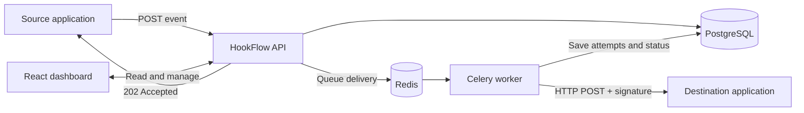

# HookFlow

### Reliable webhook delivery and event management

HookFlow is a small webhook delivery platform built with FastAPI, PostgreSQL, Redis, Celery, and React. A source application submits an event to HookFlow; HookFlow stores it, queues delivery in the background, and sends it to a registered destination. If delivery fails temporarily, HookFlow retries and records each attempt.

> The dashboard's **Send Test Webhook** form is a convenience for testing. A real source application can submit events directly to the API.

## Features

- Register, update, enable, and disable destination endpoints.
- Validate and store incoming events.
- Reject duplicate submissions using a unique `event_id`.
- Deliver events asynchronously through Celery and Redis.
- Retry transient delivery failures up to **3 attempts per delivery cycle**, with exponential backoff (5 seconds, then 10 seconds by default).
- Record delivery status, response code, errors, timing, and attempt history.
- Manually retry failed events while retaining their previous history.
- Sign outgoing webhooks with HMAC-SHA256.
- Monitor events and endpoints in a React dashboard.
- Test delivery and retry behavior with a built-in receiver simulator.

## How it works



HookFlow returns `202 Accepted` after it accepts an event for processing. The background worker delivers it independently, so the source does not have to wait for the destination. Delivery is **at least once**: destinations should use `event_id` to avoid processing the same event twice.

## Technology

| Area | Technologies |
|---|---|
| Backend API | Python, FastAPI, Pydantic |
| Database | PostgreSQL, SQLAlchemy |
| Background jobs | Celery, Redis |
| Dashboard | React, JavaScript, Vite, CSS |
| Tests and API checks | Pytest, Postman |
| Local deployment | Docker, Docker Compose, Nginx |

## Run with Docker

### Requirements

- Docker Desktop with Docker Compose
- Git, if cloning the repository

### Start

In PowerShell, from the project folder:

```powershell
if (-not (Test-Path .env)) { Copy-Item .env.example .env }
docker compose up --build -d
docker compose ps
```

Wait for the services to start. PostgreSQL and Redis should report healthy; the backend, worker, and frontend should be running.

| Service | Address |
|---|---|
| Dashboard | http://localhost:3000 |
| API documentation (Swagger) | http://localhost:8000/docs |
| API health check | http://localhost:8000/health |

To stop the services while keeping the database volume:

```powershell
docker compose down
```

The database is stored in a Docker volume and is retained when you run `docker compose down`. Avoid `docker compose down -v` if you want to keep that data.

### Try the built-in receiver

1. Open the dashboard and go to **Endpoints**.
2. Register a destination with this URL (or use the existing built-in receiver if it is already listed):

   ```text
   http://backend:8000/api/v1/receiver/webhook
   ```

3. Go to **Test Bench**. Use **Send Test Webhook** to submit an event.
4. Check **Events**, **Delivery Logs**, and **Received Webhooks** to see what happened.
5. To see retries, turn on **Simulate Failures** and select a failure mode. Turn it off when finished.

The `backend` hostname is for containers on the Compose network. It is not a public destination URL.

## Send an event from a source application

Register a destination first and use its endpoint ID. Then send an event to `POST /api/v1/events`:

```powershell
$event = @{
  event_id = "order-10029"
  event_type = "order.placed"
  endpoint_id = 1 # Replace with your registered endpoint ID
  payload = @{
    order_id = "ORD-10029"
    amount = 42.50
    currency = "USD"
  }
  max_retries = 3
} | ConvertTo-Json -Depth 5

Invoke-RestMethod `
  -Uri "http://localhost:8000/api/v1/events" `
  -Method Post `
  -ContentType "application/json" `
  -Body $event
```

The event ID is generated automatically if omitted. Reusing an ID returns `409 Conflict`. The API returns `202 Accepted` when the event is saved and queued; check the dashboard or query the API to see its final delivery status.

For a real integration, replace `localhost` with an address the source application can reach. The destination URL must also be reachable from the HookFlow worker.

## API overview

Interactive request and response examples are available at [http://localhost:8000/docs](http://localhost:8000/docs) while the app is running.

| Method | Path | Purpose |
|---|---|---|
| `GET` | `/health` | Check API and database health |
| `GET`, `POST` | `/api/v1/endpoints` | List or register destinations |
| `GET`, `PATCH`, `DELETE` | `/api/v1/endpoints/{id}` | View, update, or remove a destination |
| `POST` | `/api/v1/endpoints/{id}/toggle` | Enable or disable a destination |
| `POST` | `/api/v1/events` | Submit an event |
| `GET` | `/api/v1/events` | List and filter events |
| `GET` | `/api/v1/events/{id}` | View an event and its attempts |
| `POST` | `/api/v1/events/{id}/retry` | Manually retry a failed event |
| `GET`, `POST` | `/api/v1/receiver/config` | Read or change receiver simulation settings |
| `GET` | `/api/v1/receiver/logs` | View recent requests received by the simulator |

You can also import [`postman/HookFlow.postman_collection.json`](postman/HookFlow.postman_collection.json) into Postman.

## Run the tests

From the project folder, using the project's Python environment:

```powershell
.\.venv\Scripts\python.exe -m pytest backend\tests -v
```

The backend tests use an isolated SQLite database and mock outgoing HTTP requests; they do not require Docker services to be running. The maintained test suite has passed **40 tests**.

To build the dashboard separately:

```powershell
cd frontend
npm ci
npm run build
```

## Project layout

```text
backend/
  app/
    api/v1/       API routes for events, endpoints, and the test receiver
    core/         Settings, database, and Celery configuration
    models/       SQLAlchemy database models
    schemas/      Request and response validation
    services/     Delivery and statistics logic
    tasks/        Background delivery task
  tests/          Pytest tests
frontend/
  src/
    components/   Shared dashboard pieces and forms
    pages/        Overview, events, endpoints, logs, and Test Bench
    services/     Calls from the dashboard to the API
postman/          Postman API collection
docker-compose.yml
```

## Security and project scope

This is a local-development and portfolio project, not a production-ready public service. Incoming source requests do not currently require authentication. Rate limiting, destination URL restrictions, and production deployment configuration are not included. Do not expose the API publicly without adding appropriate security controls.

Outgoing requests include an HMAC-SHA256 signature. Configure each destination with the matching secret if it needs to verify that signature. Never use the development secrets or default database credentials for a public deployment.

The built-in receiver's simulation settings and received-request logs are held in memory and reset when the API restarts. Event records and delivery attempts are stored in PostgreSQL.
